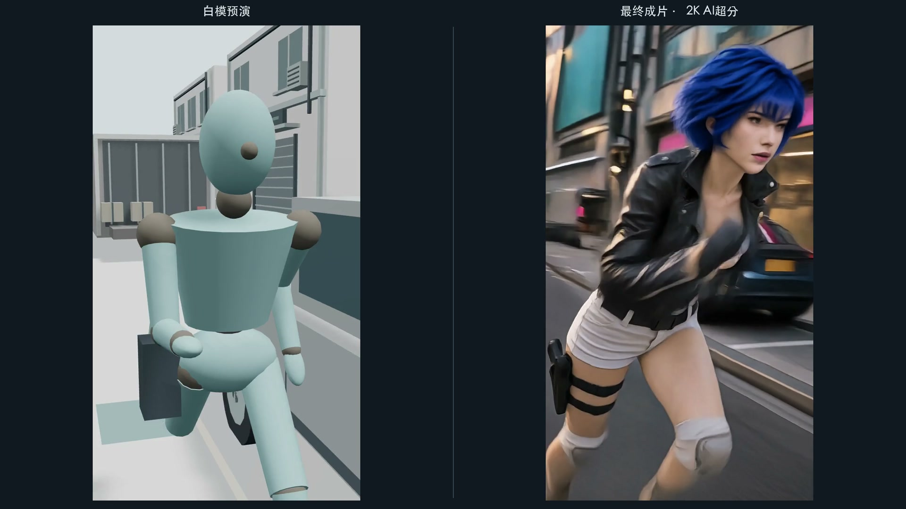
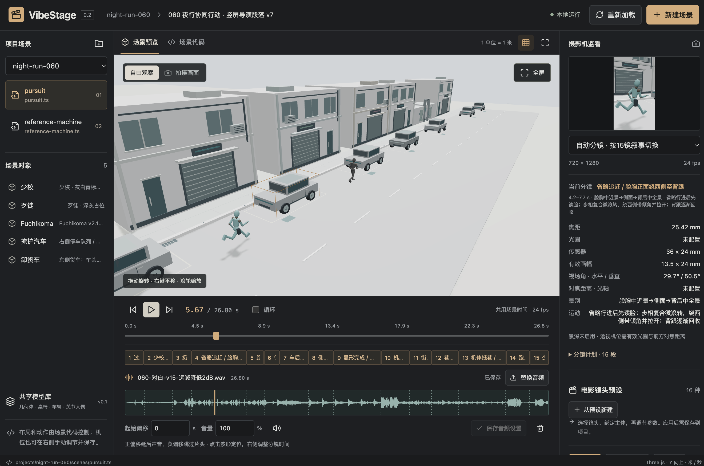

# VibeStage

基于 Three.js 的 3D 导演工作台，为 MV、短片和 AI 视频制作搭建白模参考，预演人物走位、动作与镜头，再导出参考图片或视频。

由你自己的 Agent 编写场景代码，在工作台中查看效果、微调机位和分镜。项目本地运行，不内置对话模型，无需为工作台配置模型 API Key。

## 实际效果

[](https://www.youtube.com/watch?v=7ZeO9bvJQ_Q)

[▶ 在 YouTube 观看《追捕》白模与成片对照](https://www.youtube.com/watch?v=7ZeO9bvJQ_Q)



## 主要功能

- 场景搭建：内置几何体、桌椅、车辆与关节人偶，快速搭建白模场景。
- 自定义模型：导入 GLB/glTF 模型，维护自己的私人模型库。
- Agent 编导：通过场景代码控制布局、人物姿态、移动路线与动画。
- 摄影机调节：第一人称 HUD 操控机位，调整焦距、光圈、对焦与景深。
- 运镜预设：32 项常用电影镜头，支持跟拍、推进、环绕和拉焦等。
- 分镜编排：调整镜头与切点，支持连续表演和独立摆位跳切。
- 音画同步：导入已配好的音轨，通过波形定位和调整分镜。
- 实时预览：自由观察、摄影机监看、全屏模式与可选构图参考线。
- 参考导出：输出 PNG、图片序列和 MP4，附带摄影机记录与源码快照。

## 快速开始

需要 Node.js 22.12+、npm 和支持 WebGL2 的现代浏览器。导入音频和导出 MP4 还需安装 FFmpeg（含 ffprobe）。

```sh
git clone https://github.com/smartdio/VibeStage.git
cd VibeStage
npm ci
npm run dev
```

打开终端显示的地址，默认是 http://127.0.0.1:5173 。首次打开默认进入内置的 [32 种运镜学习样板](examples/camera-school/README.md)，原版只读；点击“复制为我的项目”即可练习，也可直接新建场景。详细安装与运行说明见 [使用指南](docs/USER_GUIDE.md#安装与启动)。

## 和 Agent 一起使用

让具备本地代码编辑能力的 Agent 打开仓库，阅读 [AGENTS.md](AGENTS.md)，然后描述你想拍的画面，例如：

> 新建一个巷子场景，人物 A 慢走，人物 B 从身旁跑过；安排全景、过肩和回头特写，导出参考视频。

场景是普通的 TypeScript / Three.js 代码，可自由扩展模型、布局和动作。保存代码后，工作台自动重载预览。

你的场景保存在 `projects/`，私人模型保存在 `user-models/`，导出保存在 `exports/`；这些目录默认不提交到 Git。首次启动安装示例，后续启动不覆盖已有项目。私人内容请自行备份。

## 按需阅读

- [使用指南](docs/USER_GUIDE.md)：安装、机位操控、分镜、音频、导出与常见问题。
- [Agent 场景指南](AGENT_GUIDE.md)：场景接口、模型与动作控制，以及按需引用的专题指南。
- [私人模型指南](MODEL_GUIDE.md)：模型导入、自定义模型库和资源管理。
- [电影镜头与运镜库](docs/CAMERA_LIBRARY.md)：镜头选择、使用场景与研究参考。

## 许可证

公开框架采用 [MIT License](LICENSE)。用户自建场景、导入素材和输出作品的权利不因使用本工具而转让；详见 [授权范围](docs/LICENSING.md) 与 [第三方声明](THIRD_PARTY_NOTICES.md)。
